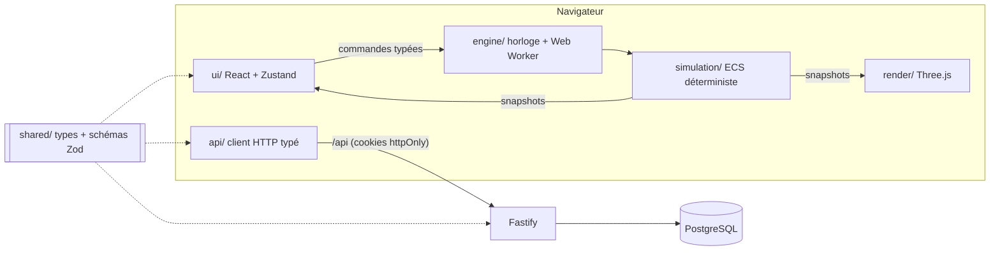
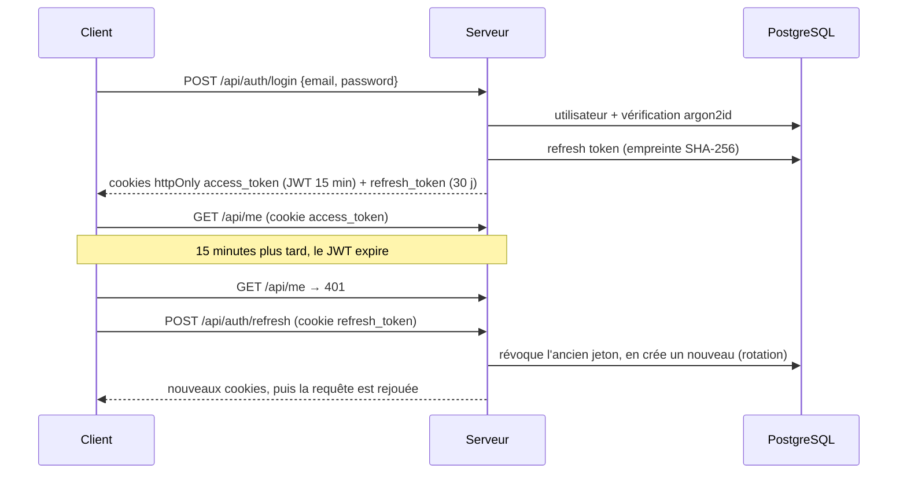

# Open Space Simulator 2026

> « Ta startup a levé 2 millions. Tu as 18 mois avant que tout explose. Bonne chance. »

Jeu de gestion de startup jouable dans le navigateur, en 3D low-poly isométrique.
Le cahier des charges complet est dans [`CLAUDE.md`](./CLAUDE.md).

**État actuel : étape 1, le socle** (monorepo, serveur, base de données, authentification
complète, i18n FR/EN, CI). Le jeu lui-même arrive dans les étapes suivantes.

## Démarrage rapide

Prérequis : Node.js 22.12+, pnpm 10 (`corepack enable`), Docker.

```bash
pnpm install
cp packages/server/.env.example packages/server/.env   # puis adapter si besoin
pnpm db:up          # PostgreSQL 16 dans Docker
pnpm db:migrate     # applique les migrations Prisma
pnpm db:seed        # crée le compte admin@oss.local / admin-dev-password
pnpm dev            # client sur http://localhost:5173, API sur http://localhost:3000
```

- Jeu : http://localhost:5173
- Documentation de l'API (Swagger UI) : http://localhost:3000/docs
- Santé du serveur : http://localhost:3000/api/health

### Connexion GitHub (facultative)

1. Sur https://github.com/settings/developers, créer une **OAuth App**.
2. _Authorization callback URL_ : `http://localhost:5173/api/auth/github/callback`.
3. Renseigner `GITHUB_CLIENT_ID` et `GITHUB_CLIENT_SECRET` dans `packages/server/.env`.

Sans ces variables, le bouton « Continuer avec GitHub » est simplement masqué.

### Scripts utiles

| Commande                                         | Effet                                                            |
| ------------------------------------------------ | ---------------------------------------------------------------- |
| `pnpm dev`                                       | Lance shared (watch), le serveur et le client                    |
| `pnpm test`                                      | Tests Vitest de tous les paquets (le serveur utilise `oss_test`) |
| `pnpm test:e2e`                                  | Tests Playwright sur 5 viewports (serveur + client réels)        |
| `pnpm lint`                                      | ESLint                                                           |
| `pnpm format`                                    | Prettier                                                         |
| `pnpm typecheck`                                 | TypeScript strict sur tout le monorepo                           |
| `pnpm build`                                     | Build de production des trois paquets                            |
| `pnpm db:migrate`                                | Crée / applique une migration Prisma                             |
| `pnpm --filter @oss/server user:promote <email>` | Donne le rôle ADMIN                                              |

Les messages de commit suivent les [commits conventionnels](https://www.conventionalcommits.org/fr/)
(`feat:`, `fix:`, `docs:`...), vérifiés par un hook `commit-msg` (husky + commitlint).

## Architecture



### Monorepo

```
packages/
├── shared/   Types et schémas Zod communs (DTO d'API, codes d'erreur, constantes de jeu)
├── server/   Fastify + Prisma + PostgreSQL
│   ├── prisma/          schema.prisma, migrations, seed
│   ├── src/config/      variables d'environnement validées par Zod
│   ├── src/plugins/     sécurité, erreurs, JWT, Prisma, Swagger
│   ├── src/routes/      auth, me, admin, health
│   ├── src/services/    sessions, mots de passe, GitHub OAuth, utilisateurs
│   └── tests/           tests d'intégration (vraie base PostgreSQL)
└── client/   Vite + React + i18next (Three.js à l'étape 2)
    ├── src/             voir src/README.md pour le rôle de chaque dossier
    └── tests/           unit/ (Vitest) et e2e/ (Playwright)
```

Le paquet `shared` est la source de vérité des contrats : le serveur valide les entrées avec
les schémas Zod, le client valide les réponses avec les mêmes schémas. Un changement d'API
casse donc la compilation des deux côtés.

### Authentification



- **Mots de passe** : argon2id. Message identique pour un email inconnu ou un mauvais mot de
  passe, avec un temps de réponse comparable.
- **Jetons** : JWT d'accès court + refresh token opaque, tous deux en cookies `httpOnly`
  (inaccessibles au JavaScript, donc aux attaques XSS). Le refresh token n'est envoyé qu'aux
  routes `/api/auth`. En base, seule son empreinte est stockée.
- **Rotation et détection de vol** : chaque refresh token ne sert qu'une fois. Si un jeton
  déjà utilisé est présenté, toutes les sessions de l'utilisateur sont révoquées.
- **GitHub OAuth** : paramètre `state` signé contre le CSRF ; liaison automatique à un compte
  existant uniquement si GitHub certifie l'email.
- **Rôles** : `USER` et `ADMIN`, vérifiés par `app.requireRole('ADMIN')`.
- **Protections** : Helmet, CORS restreint au client, rate limiting (global + 10 tentatives
  par minute sur la connexion), logs structurés pino sans cookies.
- **Erreurs** : toujours `{ error: { code, message } }` ; le client traduit le `code`.

### Choix techniques

| Choix                                                                                                    | Pourquoi                                                                                                                                                 |
| -------------------------------------------------------------------------------------------------------- | -------------------------------------------------------------------------------------------------------------------------------------------------------- |
| Client et API sur la **même origine** (`/api`) via le proxy Vite en dev et une réécriture Vercel en prod | Les cookies de session restent « first-party » : pas de cookies tiers (bloqués par Safari et bientôt Chrome), pas besoin de `SameSite=None`.             |
| **Prisma 7** avec l'adaptateur `pg`                                                                      | Version actuelle de Prisma : plus de moteur Rust à embarquer, client TypeScript généré dans `src/generated`.                                             |
| **TypeScript 6.0**                                                                                       | TypeScript 7 (réécriture en Go) n'est pas encore supporté par typescript-eslint.                                                                         |
| **Zod 4** + `fastify-type-provider-zod`                                                                  | Un seul schéma sert à valider, typer et documenter (OpenAPI) chaque route.                                                                               |
| Tests serveur sur une **vraie base**                                                                     | Les contraintes d'unicité et la rotation des jetons sont testées pour de vrai, pas simulées.                                                             |
| Règle ESLint sur `simulation/` et `events/`                                                              | Interdit d'y importer Three.js, React ou le DOM, ainsi que `Math.random` et `Date.now` : la simulation reste déterministe et exécutable sans navigateur. |

## Ce que l'application fait et ne fait pas

Elle fera : un jeu de gestion solo complet, jouable hors ligne en invité, avec classements en
ligne, replays et un Slack optionnellement animé par l'IA.

Elle ne fait pas : de multijoueur en temps réel, d'achats intégrés ni de publicité, de chat
entre joueurs, d'application mobile native (PWA uniquement), ni d'assets payants. L'IA ne
génère que des messages Slack.

## Crédits

- Modèles 3D, UI et sons : [Kenney](https://kenney.nl) (licence CC0), intégrés à partir de
  l'étape 2.
