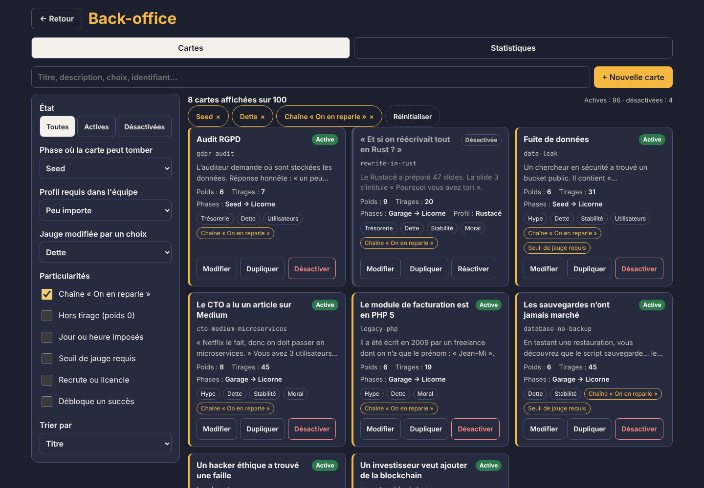
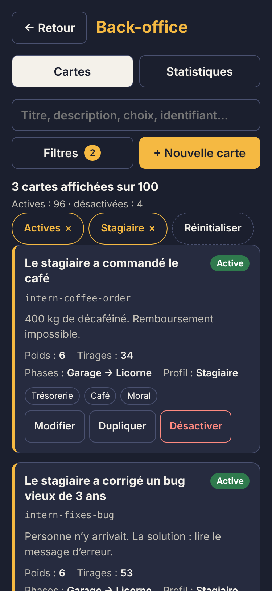

# Back-office

> Extrait du [`README`](../../README.md), section Architecture.

Réservé au rôle ADMIN (vérifié par le serveur sur chaque route `/api/admin/*`), ouvert depuis le
bouton 🛠 du menu principal.

- **Cartes** : chaque carte est une tuile avec son titre, son identifiant, sa description, son
  poids, son nombre de tirages, les phases où elle peut tomber, le profil requis, les jauges que
  ses choix modifient et ses particularités. Actions : modifier, dupliquer (ouvre l'éditeur avec
  un identifiant libre, carte désactivée par défaut) et désactiver ou réactiver en un clic.
- **Filtres combinables** : recherche plein texte (titre, description, choix et identifiant, en
  français et en anglais, sans tenir compte des accents), état, phase, profil requis, jauge
  modifiée, particularités (chaîne « On en reparle », hors tirage, jour ou heure imposés, seuil
  de jauge, recrute ou licencie, débloque un succès) et tri (titre, poids, tirages, dernière
  modification). Les filtres actifs s'affichent en pastilles retirables et restent en mémoire
  pendant la session. Sur ordinateur ils sont dans une colonne à gauche, sur mobile dans un
  panneau qui se replie. La logique est dans `ui/admin/cardFilters.ts` (fonctions pures, testées).
- **Éditeur** : JSON validé en direct par le schéma Zod partagé, avec l'aperçu de la carte telle
  que le joueur la verra.
- **Packs de personnages** : Noël, Halloween, Pâques, super-héros (héros inventés, sans
  licence), été, espace, pirates, Moyen Âge, années 80 et cyberpunk. Un pack déguise toute l'équipe : chaque profil a son costume construit en Three.js
  (Père Noël barbu, stagiaire citrouille, oreilles de lapin, cape et emblème…), avec un aperçu 3D
  des 8 profils. Le pack « Base » (les looks habituels, sans costume) est le seul actif au départ ;
  si plusieurs packs sont actifs, l'équipe se répartit entre eux (Base et Noël : la moitié en
  costume), et si aucun ne l'est, on revient aux looks de base. Le client lit `GET /api/character-packs` au lancement d'une partie et le garde en cache
  pour le hors-ligne ; l'administrateur les change avec `PUT /api/admin/character-packs/:id`.
  Costumes dans `render/characterPacks.ts`.
- **Décorations** : un thème par période de l'année (Nouvel An, Saint-Valentin, Pâques, espace,
  Moyen Âge, super-héros, années 80, été, pirates, Halloween, cyberpunk, Noël). Chacun a une
  guirlande murale (fil et ampoules qui scintillent, ou cordelette et fanions, tendus en festons
  entre des clous), un ornement accroché entre deux appliques (jamais devant une fenêtre, une
  cloison ou un grand meuble : `decorWalls` dans `render/decorations.ts`) et un petit objet par
  bureau, à l'écart de l'écran et des accessoires, construits en Three.js et fusionnés par
  matériau (4 appels de dessin au plus par mur), avec un aperçu 3D. Deux thèmes actifs se
  partagent les murs au lieu de s'empiler. Rien
  n'est posé au sol : le joueur ne pourrait ni déplacer ni ranger un objet qu'il n'a pas acheté. Trois réglages par thème : désactivé, en saison (par défaut, seulement pendant sa
  période) ou toujours. `GET /api/decor-themes` (public, en cache hors ligne) et
  `PUT /api/admin/decor-themes/:id`.
- **Statistiques** : joueurs, parties, fins, faillites par phase, cartes les plus tirées et choix
  les plus fréquents, avec des barres proportionnelles.

| Liste et filtres (ordinateur)                                   | Filtres (mobile)                                           |
| --------------------------------------------------------------- | ---------------------------------------------------------- |
|  |  |
