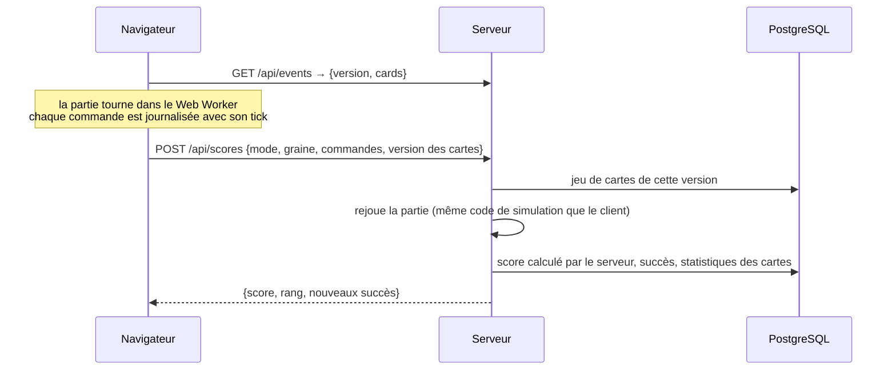
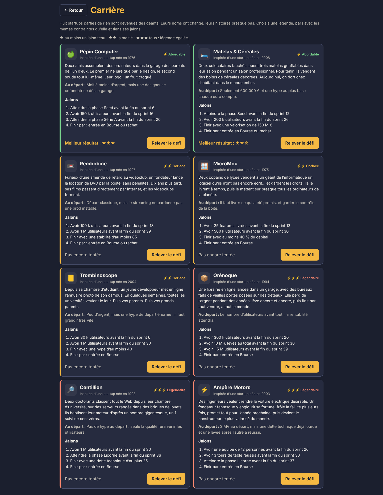
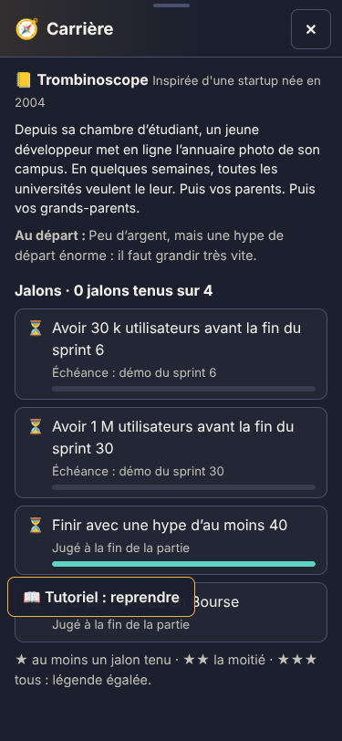

# Méta-jeu et anti-triche

> Extrait du [`README`](../../README.md), section Architecture.

- **Anti-triche** : le serveur ne croit que la graine et la liste des commandes. Il importe la
  simulation du client (`@oss/client/simulation`, TypeScript pur) et rejoue la partie : issue,
  valorisation et succès viennent de ce rejeu. Un score « annoncé » différent est refusé
  (`SCORE_MISMATCH`), une partie inachevée aussi (`GAME_NOT_FINISHED`).
- **Versions des cartes** : l'ordre et le contenu des cartes changent le tirage. Chaque jeu de
  cartes servi par `GET /api/events` porte une empreinte (`version`) gardée en base : une partie
  se rejoue toujours avec les cartes qu'elle a connues, même après une modification dans le
  back-office. Hors ligne, le jeu utilise le cache ou les 130 cartes intégrées (`builtin`).
- **Replays** : `GET /api/scores/:id/replay` renvoie graine, commandes et cartes ; le moteur les
  rejoue en accéléré (les commandes du joueur sont bloquées).
- **Daily** : graine `daily-AAAA-MM-JJ`, la même pour tous ; un seul score par joueur et par jour.
- **Mode illimité** (`ENDLESS`, `packages/shared/src/sim/endless.ts`) : pas de fin au 39e sprint,
  la partie dure tant que la trésorerie tient (ou jusqu'à une IPO ou un rachat accepté). Après
  les 18 mois, la concurrence pèse un peu plus à chaque sprint : frais fixes en hausse
  (+4 % par sprint, plus une part au carré), départs d'utilisateurs en plus, levées de plus en
  plus petites ; un message tous les 6 mois. Les 18 premiers mois sont identiques au mode Normal
  pour une même graine. 3 succès (2, 3 et 5 ans tenus). Les bots tiennent de 76 à 300 sprints.
- **Classements des meilleures entreprises** (`ui/meta/Leaderboard.tsx`), ouverts depuis le menu
  principal et en jeu (bouton 🏆 en haut à droite, sans replay pour ne pas quitter la partie) :
  « En ligne » (tous les joueurs connectés, scores vérifiés par le serveur) ou « Sur cet
  appareil » (parties terminées ici, même en invité et sans serveur, `save/localScores.ts`).
  Chaque partie a un nom d'entreprise tiré de sa graine par hachage (`companyName`, sans
  tirage) que le serveur retrouve aussi. Onglets global, Daily du jour et par mode ; le global
  exclut le Facile, l'Illimité et la Carrière ; l'Illimité se classe aux sprints tenus puis à la
  valorisation (`compareGames`, même règle côté serveur).
- **Carrière** : refaire le parcours de 8 startups devenues géantes, jamais nommées (Pépin
  Computer, Matelas & Céréales, Rembobine, MicroMou, Trombinoscope, Orénoque, Centillion, Ampère
  Motors ; `packages/shared/src/sim/career.ts`). Chaque légende impose son départ (argent, hype,
  dette, premier profil, parfois un cofondateur) et 4 jalons : une phase, des utilisateurs, une
  levée ou une équipe avant un sprint donné, puis une façon de finir. Les jalons sont vérifiés à
  chaque démo, sans un seul tirage (`client/src/simulation/career.ts`) ; à la fin, ★ pour au
  moins un jalon, ★★ la moitié, ★★★ tous, écrit dans la phrase partageable. La légende est dans
  la graine (`career:<légende>:<graine>`) : replays, sauvegardes et vérification du score par le
  serveur marchent sans rien de plus. Bouton 🧭 en haut de l'écran pour suivre les jalons,
  meilleur résultat de chaque légende gardé sur l'appareil, classement « Carrière » et 2 succès.

| Choix de la légende                                       | Jalons en partie (mobile)                             |
| --------------------------------------------------------- | ----------------------------------------------------- |
|  |  |

- **Sauvegardes** : 5 emplacements (le 1er reçoit une sauvegarde automatique à chaque sprint),
  gardés dans IndexedDB puis synchronisés avec le serveur à la connexion. « Continuer » reprend
  la sauvegarde la plus récente d'une partie en cours : à la fin d'une partie, sa sauvegarde
  automatique est effacée et ses sauvegardes manuelles ne sont plus proposées (elles restent
  dans « Charger une partie »). Sous « Continuer », le bouton « Nouvelle partie » lance une
  partie dans le mode suggéré, et les cartes des modes restent disponibles.
- **Succès** : 70 succès, vérifiés par la simulation à partir de l'état (donc infalsifiables) ou
  débloqués par des cartes. Chacun a une difficulté (facile, intermédiaire, difficile,
  légendaire) ; 22 sont secrets : leur nom est visible et compté avec les autres, mais leur
  condition reste « ??? » tant qu'ils ne sont pas débloqués. Un écran « Succès » est accessible
  depuis le menu principal ; `pnpm balance` mesure le taux de déblocage de chacun par les bots
  pour vérifier la difficulté annoncée.
- **Mode Histoire** : 4 chapitres et 10 missions (`packages/shared/src/story/campaign.ts`),
  chacune une partie `STORY` avec un point de départ, des objectifs et des contraintes vérifiés
  par la simulation (`client/src/simulation/story.ts`). Une mission réussie est envoyée à
  `POST /api/story/complete`, qui la rejoue comme un score avant de la garder (table
  `StoryMission`) ; un invité la garde sur l'appareil jusqu'à sa connexion. Chaque mission
  débloque une récompense (papier peint, sol, couleur, objet ou bonus de départ) utilisable en
  Facile, Normal et dans les défis, jamais en Daily. Les récompenses d'une partie sont fixées au
  départ, envoyées avec le score et rejouées par le serveur, qui refuse celles qui ne sont pas
  gagnées sur le compte (`UNLOCK_NOT_EARNED`). Les missions n'ont pas de classement.
- **Histoire en 5 actes** (« Ctrl+Alt+Fonder », `packages/shared/src/story/acts.ts`) : une seule
  longue partie de 60 sprints, du garage à la Bourse. Chaque acte a un objectif principal avec
  une date limite et des objectifs secondaires, qui sont les 10 missions courtes (mêmes
  récompenses, même vérification par rejeu côté serveur, avec `campaign: true`). Un point de
  sauvegarde est pris au début de chaque acte sur l'appareil, pour reprendre un acte raté. Les
  missions courtes restent jouables dans l'onglet « Missions ». Calibrage : `pnpm balance:campaign`.
  Trois rivaux inventés (Synergix, Pivotly, Gigacorp, `packages/shared/src/sim/rivals.ts`) se
  partagent le marché avec le joueur, agissent contre lui (copie, débauche, procès, prix cassés,
  clone) et ont leur enseigne sur un toit de la ville ; panneau « 📈 Marché ». Leur hasard vient
  d'une graine à part (`seed#rival#sprint`).
  Scènes dialoguées à chaque acte, 10 cartes écrites pour l'histoire (`shared/story/cards.ts`,
  imposées à un sprint fixé, sans tirage), SMS de Mamie Josette et articles d'Inès Kader dans le
  Slack, deux fins écrites (rachat par Gigacorp, ou entrée en Bourse puis Saison libre sans limite,
  avec une nouvelle startup rivale tous les 10 sprints). Chaque objectif secondaire rempli donne
  un bonus d'histoire (argent, hype, utilisateurs). Équilibrage mesuré par un bot « conteur » dans
  `pnpm balance` (section « Histoire en actes » de `docs/balance.md`).
  **Arbre R&D des objets** (`packages/shared/src/sim/research.ts`, panneau « 🔬 R&D ») : dans
  tous les modes, le catalogue de construction démarre réduit et se débloque avec des points
  d'innovation (features livrées ; dans l'histoire, objectifs remplis et sprints gagnés face aux
  rivaux ; ailleurs, levées de fonds réussies et objectifs de sprint atteints). 5 branches de 4
  niveaux (Confort, Tech, Ambiance, Cuisine, Organisation), chaque niveau demandant le précédent
  et son acte (histoire) ou sa phase (autres modes), plus dans l'histoire une branche Prestige :
  les récompenses des objectifs, achetables dès l'objectif rempli. Le verrou passe par la
  simulation (commande `RESEARCH_NODE`, achats refusés avec `LOCKED`), aucun tirage ; les missions
  courtes et les vieilles sauvegardes gardent tout le catalogue.
- **Slack IA** (facultatif) : le client envoie un résumé (phase, jauges, devs), jamais l'état
  complet ; le serveur appelle Claude avec une sortie structurée, applique un quota par joueur
  et par jour et met les réponses en cache. Sans clé, en cas d'erreur ou de quota atteint, le
  jeu retombe sur ses 256 templates. L'IA n'écrit que des messages.
- **PWA** : `vite-plugin-pwa` met en cache le code, les modèles Kenney et les icônes ; une
  partie en invité se lance sans réseau (testé par Playwright). Après un déploiement, la
  nouvelle version s'applique d'elle-même au menu, ou au retour au menu pendant une partie
  (`ui/appUpdate.ts`). Le bas du menu principal affiche la version du jeu (numéro, commit
  et date du build, `src/version.ts`) pour savoir laquelle tourne.
