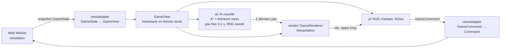

# Rendu 3D et interface

> Extrait du [`README`](../../README.md), section Architecture.

- **Frontière unique** : `view/types.ts` décrit ce que le rendu et l'interface lisent (`GameView`)
  et les commandes qu'ils envoient (`GameCommand`). `view/adapter.ts` traduit l'état de la
  simulation dans ce modèle (fonctions pures, testées) et `view/source.ts` le relie au moteur
  qui tourne dans le Web Worker. Les règles (prix, emprise, effets des objets) restent dans la
  simulation ; `view/catalog.ts` n'ajoute que l'habillage (modèle 3D, catégorie).
- **Étapes du sprint** : planification (Kanban, recrutement, levée de fonds), exécution, cartes
  d'événements avec effets affichés, démo de fin de sprint, mini-jeu de pitch, fin de partie.
- **Scène** : caméra orthographique isométrique (35,26°, rotation par quarts de tour), sol et
  murs par phase (Garage, Seed, Série A, Licorne), mobilier en `InstancedMesh`, cycle jour/nuit,
  ombres, contour de sélection et léger bloom (post-processing).
- **Ambiance** : l'écran d'un dev s'allume quand il travaille, avec un contenu propre à son
  métier ; appliques murales et halos, plafonniers, fenêtres couleur du ciel et taches de
  soleil le jour ; les lampes prennent le relais le soir.
- **Personnages** : l'IA décide où chacun marche (A\* 8 directions, évitement entre collègues)
  et quelle posture il prend selon son activité ; le rendu joue le clip GLB correspondant ou une
  animation procédurale, et affiche des bulles de pensée traduites.
- **Contrôles** : glisser pour déplacer, molette ou pincer pour zoomer, appui long pour
  sélectionner sur mobile, flèches, `+`/`-`, `Q`/`E` au clavier.
- **Qualité réglable** (bas, moyen, haut) : devicePixelRatio plafonné à 2, ombres coupées en
  bas (défaut sur mobile et quand WebGL tourne sans carte graphique, comme sur la CI), petits
  objets masqués quand on dézoome (LOD).
- **Vue sur New York** : on la voit par les fenêtres achetées. Le bureau est au
  dernier étage d'une tour, au milieu d'une ville low-poly façon Manhattan (avenues, tours à
  gradins, réservoirs d'eau sur les toits, parc, fleuve, circulation), faite de formes
  Three.js sans aucun bâtiment réel. Sept modèles de véhicules roulent dans les rues
  (`render/cars.ts`) : taxi à enseigne et damier, berline, citadine, SUV, camionnette, pick-up et
  bus, avec vitres, roues, phares et pare-chocs ; modèle et couleur figés par le numéro de la
  voiture, deux InstancedMesh par modèle. La ville est la même à chaque partie (graine fixe, sans le
  hasard du jeu) et tient en une quinzaine d'appels de dessin. Aucun toit proche ne dépasse le
  plancher, donc rien ne cache la salle. Les façades sont dessinées par shader en 5 styles
  (verre qui reflète le ciel, brique, pierre, bandeaux, brownstone), les toits ont muret,
  climatiseurs et réservoirs, les rues leurs marquages. Les fenêtres s'allument et s'éteignent
  une à une selon l'heure du jeu : les bureaux se vident le soir, les logements se remplissent,
  des télés scintillent ; couronnes des tours, lampadaires, phares des voitures, balises et
  avions s'allument la nuit (`render/skyline.ts`, `render/skylineShaders.ts`,
  `render/cityLights.ts`).
- **Écran de jeu** : en haut ce qu'on lit (phase, équipe, mois de trésorerie restants, six
  jauges avec icône, tendance et couleur, horloge et avancement du sprint) ; en bas ce qu'on
  fait (dock d'actions et commande de l'étape : lancer le sprint, lever des fonds, vitesses).
  L'horloge défile minute par minute (environ 5 min réelles par sprint à x1) alors que la
  simulation avance par pas de 30 min : l'affichage interpole entre deux pas.
  Les cartes d'événement gardent les jauges visibles, montrent les effets en pastilles et se
  choisissent aussi avec les touches 1 à 3. Tant qu'une carte est ouverte, le sprint est en
  pause ; la vitesse d'avant reprend après la réponse (sauf en Hardcore, où le temps continue).
- **Télétravail automatique** : chaque matin de semaine, la simulation envoie en télétravail
  les devs sans bureau libre, épuisés, en conflit avec un collègue ou accros privés de café (le
  Dev Fantôme l'est toujours). Ils disparaissent de l'open space, se fatiguent moins mais
  perdent 15 % de vitesse et 5 % de qualité ; la fiche, l'équipe et Slack l'affichent.
- **Vraies pauses** : chaque jour de semaine, pause à 10h30, déjeuner à midi (1 h) et pause à
  15h, un dev sur deux décalé de 30 min (`BALANCE.breaks`). Pendant une pause courte, le dev
  choisit selon son caractère un café, une partie de babyfoot ou une balade dans la cuisine ; il
  déjeune à la cuisine ou à la cantine. Le noctambule décale tout de 2 h, le bourreau de travail
  ne garde que le déjeuner, l'IA Agent ne s'arrête jamais. À l'écran, une demi-heure de jeu ne
  dure que 0,45 s à x1 : les personnages arrivent directement à leur bureau le matin et vont au
  bout de ce qu'ils ont commencé avant de suivre la simulation (`ai/agents.ts`).
- **Performance des devs** : chaque dev a une note globale de S à D (sur 100), mesurée sur ses
  2 derniers sprints (50 % productivité, 35 % qualité, 15 % endurance, bonus du Product Owner et
  de la Designeuse, −5 par panne provoquée). La productivité est le travail produit par heure
  passée sur une tâche, 100 % = un dev standard (référence mesurée sur des parties simulées,
  `BALANCE.performance`). La fiche montre les 2 derniers sprints côte à côte, l'ancienneté,
  l'XP, la tâche en cours, l'allié et la bête noire ; chaque candidat affiche sa performance
  estimée, le salaire du marché et ses chances d'accepter l'offre.
- **Équipe web** : 10 métiers s'ajoutent aux 8 profils. Les devs Front et Back vont 15 % plus
  vite de leur côté de la stack et à 60 % de l'autre ; leur spécialité (React, accessibilité,
  performance web, mobile, Node.js, bases de données, sécurité, cloud) accélère un type de tâche
  de 20 %. Le dev Fullstack prend les deux côtés à 85 %, avec une qualité plus faible. Le Tech
  Lead réduit la dette des features, le DevOps ajoute de la stabilité chaque jour, les testeurs
  ont leurs tâches de recette (🔍) et réduisent la dette. L'encadrement ne prend pas de tâches :
  scrum master (réunions du PO allégées), managers (1 pour 6 personnes : productivité, moral,
  conflits apaisés), sous-directeur et directeur technique (productivité, moral, hype). Les
  postes s'ouvrent selon la taille de l'équipe et la phase ; le bloc « Encadrement » du panneau
  Équipe résume les effets et les postes ouverts. Chaque planification propose 2 candidats de
  l'équipe web en plus des 3 habituels, sur une graine à part (`shared/sim/teamRoles.ts`,
  `client/src/simulation/leadership.ts`).
- **Filtres de l'équipe** : la liste se filtre par note de performance, situation (en conflit,
  fatigué·e, moral bas, télétravail, au bureau) et métier, filtres cumulables, et se trie par
  performance, moral, énergie, conflits, salaire, ancienneté ou nom. Chaque ligne indique
  le nombre de collègues en conflit (⚔️).
- **Interface** : jauges avec infobulles, vitesses, Kanban en glisser-déposer (souris et
  tactile, ou flèches au clavier), fiches des devs, recrutement avec négociation, mode
  construction, dashboard, options d'accessibilité, tutoriel, crédits. Panneaux latéraux
  sur ordinateur, bottom sheets plein écran sur mobile.
- **Calendrier, saisons et anniversaires** : la partie commence le lundi de la semaine réelle
  (date inscrite dans la graine). L'année est découpée en 12 périodes d'environ une semaine
  (Nouvel An, Saint-Valentin, Pâques, espace, Moyen Âge, super-héros, années 80, été, pirates,
  Halloween, cyberpunk, Noël) : pendant chacune, ses cartes de saison (24 au total) passent en
  priorité et le bureau se décore à son thème. Chaque dev a un anniversaire tiré de la graine
  sans toucher au tirage du jeu : table de fête, +moral, confettis et message Slack (fêté le
  lundi s'il tombe un week-end).
- **Filiales (Investir)** : à partir de la Série A, la startup peut investir sa trésorerie pour
  créer jusqu'à trois autres startups (trois projets proposés par sprint : prudent, audacieux,
  moonshot). Elle garde 80 % de chaque filiale, dont la valorisation évolue à chaque démo ;
  une filiale verse des dividendes, peut couler, et ses parts se revendent à tout moment en
  planification. L'entreprise devient un groupe : ses parts comptent dans la valorisation
  (Licorne, IPO, rachat, classement), chaque filiale ajoute une aile « incubateur » au bureau
  avec son enseigne et deux places dans l'équipe, et six cartes « filiales » peuvent tomber.
  Le hasard des filiales est tiré sur une graine à part (graine + filiale + sprint) : une partie
  sans filiale reste identique au bit près, donc les anciens replays et le Daily restent valides.
- **Levées de fonds** : le bouton « Lever des fonds » ouvre un panneau avec le prochain tour de
  table et sa difficulté. Chaque tour est plus dur (Seed, Série A, B, C, D puis pré-IPO) :
  plus de questions (3 à 5) et de réponses proposées (3 à 4), une barre plus haute, des
  bluffs démasqués plus souvent, des arguments qui demandent de vrais chiffres, de gros fonds
  (souverain, crossover) et, dès la Série B, un investisseur qui peut quitter la salle. À chaque
  manche il pose une question (traction, technique, équipe, vision, buzzword) : une réponse hors
  sujet fait baisser son intérêt, affiché avec ses réactions. Avant d'entrer, le panneau donne
  les chances estimées et la force de chaque thème d'argument d'après l'état de la startup ;
  pendant le pitch, chaque argument proposé indique sa force (fort, moyen, faible), la jauge sur
  laquelle il s'appuie et s'il se joue aux dés, et la jauge « Chance de signer » est la vraie
  probabilité que l'investisseur signe (`estimatePitchChance`, `categoryStrengths`,
  `pitchRating`). Quatre autres financements, sans
  hasard : business angels (6 % du capital), prêt bancaire (remboursé sur 12 mois), financement
  participatif (+hype, +dette) et subvention à l'innovation (-moral). Questions et bluffs sont
  tirés sur une graine à part (graine + pitch + sprint) (`shared/sim/pitch.ts`,
  `shared/sim/funding.ts`, commande `TAKE_FINANCING`, état `financing`).
- **Annexes du bureau** : dès la Série B, chaque tour réussi ouvre une annexe sur toute la
  largeur du bureau (salle d'arcade, jardin intérieur, auditorium) avec son décor offert et deux
  places de plus dans l'équipe. Ce décor se sélectionne, se tourne et se déplace comme le
  mobilier (commande `MOVE_ANNEX_DECOR`, `shared/sim/annexDecor.ts`), et les mêmes objets sont
  en vente avec un vrai effet (borne d'arcade, flipper, enseigne néon, arbre, fontaine, banc,
  scène, pupitre, écran géant). Les sols des autres pièces changent d'une partie à l'autre
  (parquet, damier, terre cuite, moquette…), selon la graine (`view/layout.ts`,
  `render/annexDecor.ts`).
- **Tâches dynamiques** : le backlog garde jusqu'à 2,5 idées par dev. Pendant le sprint, des
  urgences tombent : « Réparer la prod » à chaque panne, et au hasard (plus souvent avec une
  grande équipe) une faille de sécurité, le « petit bouton » du gros client, un paiement cassé,
  une demande RGPD ou une démo qui plante. Chacune a un délai en heures ouvrées, un message et
  un bandeau rouge qui ouvre le Kanban ; les devs libres la prennent en premier. Finie à temps,
  petit bonus ; ratée, elle disparaît et sa pénalité tombe. Chaque lundi à 9h, 1 à 3 tâches de
  la semaine sont à finir avant vendredi 18h. Environ 4 sprints sur 10 ont un objectif (livrer
  N features, finir N tâches, zéro panne, baisser la dette, gagner N utilisateurs), facile,
  moyen ou difficile, récompensé à la démo selon sa difficulté. Le hasard est tiré sur une
  graine à part (`shared/sim/taskFlow.ts`, `client/src/simulation/taskFlow.ts`).
- **Charge du sprint selon l'équipe** (`client/src/simulation/sprintLoad.ts`) : 3 idées par
  personne qui prend des tâches et par sprint (`TASK_FLOW.ideasPerDev`, l'encadrement ne compte
  pas), backlog jusqu'à 4 par dev. Chaque matin de semaine à 9h, le rythme de chaque métier depuis
  le début du sprint (`tracker.workByTrade`) est comparé au travail restant : s'il manque de quoi
  tenir jusqu'à la démo, des tâches passent du backlog au « À faire », sinon de nouvelles idées
  sont créées (`TODO_TOPPED_UP`) ; à 14h, un dev qui attend sans tâche en reçoit une. Au 6e jour
  ouvré, une équipe nettement en retard est prévenue (`SPRINT_BEHIND`), rien n'est retiré. Ligne
  au-dessus du Kanban : équipe, tâches finissables d'ici la démo, tâches prévues. Les devs ne
  chôment plus (avant : environ 60 % du temps sans tâche), donc tâches du backlog plus longues
  (`BALANCE.work.unitsPerPoint` 5 → 14, urgences et hebdo à 5) et chaque point livré pèse moins
  (`BALANCE.work.pointEffect` 0,13). Nouvelles idées sur `seed#tasks#topup#…` ; règle qui change
  toutes les parties (anciens replays de scores divergent). 192 titres de plus
  (`data/moreTasks.ts`, 439 au total), 5 urgences et 5 tâches de la semaine de plus, 150 titres
  récents gardés.
- **Tâches par métier** : chaque carte du Kanban affiche son métier, 💻 Code, 🎨 Design (la
  designeuse) ou 📋 Produit (le Product Owner). Les nouvelles idées suivent les métiers présents
  dans l'équipe, et une tâche que le joueur n'assigne pas lui-même ne part qu'à quelqu'un du bon
  métier, urgences d'abord. Le joueur peut toujours confier une tâche à n'importe qui (les autres
  métiers sont rangés à part dans la liste) : hors métier, elle avance à 60 %. Une carte dont le
  métier n'a personne dans l'équipe le signale. Le bouton « Tout en À faire » passe tout le
  backlog dans la colonne À faire en un clic (une seule commande, rejouable).
- **Salles de réunion** : dès la Seed, le bouton « 🗓️ Réunion » du dock ouvre le panneau de la
  salle de réunion. Six formules, chacune avec un bonus et un malus : stand-up (réunions du PO
  deux fois moins chères, léger −moral), brainstorming (+qualité, réunions du PO qui débordent),
  aquarium vitré (+hype, −productivité), puis en Série A salle zen (+moral et récupération,
  −productivité) et war room (+stabilité, −moral), et en Licorne salle du conseil (+hype et
  qualité, petits-fours hors de prix). Chaque matin de semaine à 9h, dès son arrivée, l'équipe s'y
  réunit 20 minutes : utile, la réunion rapporte (dette, hype, stabilité ou moral) ; inutile, elle
  coûte. Quand la prod tombe, la salle devient une cellule de crise : le coupable, les devs les plus
  solides (DevOps et Tech Lead d'abord) et le PO ou un manager s'y réunissent une demi-heure, puis
  le meilleur prend « Réparer la prod », déjà avancée de 15 % (brainstorming) à 50 % (war room). Changer de
  formule ou vider la salle rend 50 % du prix. Chaque formule a son rendu 3D (modèles Kenney et
  formes Three.js) et les devs s'assoient autour de la table. Le hasard est tiré sur une graine à
  part (`shared/sim/meetings.ts`, `client/src/simulation/meetings.ts`, `render/meetingRoom.ts`).
- **Daily et Kanbanana** : le Daily de 9h fait le point sur les tickets. Chacun dit où en est
  son ticket (hier, aujourd'hui) ; un Daily utile donne +5 % de productivité aux participants
  jusqu'au soir. Sans Daily, ou pour ceux en télétravail, deux devs finissent parfois par coder la
  même chose à 10h et une partie d'un ticket est à refaire (dès la Seed, graine à part). Dans la
  salle, un écran se déroule et un projecteur de plafond affiche **Kanbanana**, l'appli de tickets
  du jeu (nom et logo inventés) ; le bandeau du Daily ou le bouton « 📽️ Voir Kanbanana » du panneau
  Réunion l'ouvrent en grand. Le temps s'arrête 6 s au début du Daily pour voir l'équipe s'asseoir
  (option désactivable, jamais en Hardcore ni en replay) (`view/ticketBoard.ts`,
  `render/dailyBoard.ts`, `ui/meetings/TicketApp.tsx`, `ui/meetings/DailyMoment.tsx`).
- **Variété des tâches** : le Kanban pioche dans plus de 250 tâches en français et en anglais.
  Le catalogue grandit avec la startup (page de tarifs en Seed, découper le monolithe en Série A,
  certification SOC 2 en Licorne), et pendant chaque période du calendrier une tâche de code sur
  trois est de saison (calendrier de l'Avent à Noël, code zombie à Halloween). La designeuse et
  le Product Owner ont deux fois plus d'idées, et les urgences et tâches de la semaine sont deux
  fois plus nombreuses. Une tâche n'apparaît jamais deux fois sur le tableau, et les 60 dernières
  ne reviennent pas tant qu'il en reste de neuves (`client/src/simulation/taskTitles.ts`).
- **Demandes d'augmentation** : tous les 5 à 10 sprints, si l'équipe compte au moins 3 devs, un
  dev peut demander une augmentation de 10 à 20 % pendant la planification. Une fenêtre annonce
  les conséquences : accepter relève son salaire, son moral et deux compétences ; refuser le fait
  démissionner une fois sur deux (il part deux planifications plus tard, badge « 🚪 » dans
  l'équipe), sinon il reste démotivé et perd deux compétences. Réglages dans `BALANCE.raises` ;
  le hasard est tiré sur une graine à part, sans toucher au tirage du jeu.
- **Arbre de compétences des devs** : chaque niveau gagné donne un point, à dépenser dans
  l'onglet « Compétences » de la fiche du dev (badge ⭐ dans la liste de l'équipe). 3 branches de
  5 nœuds, chacun demandant le précédent : 🛠️ Technique (code propre, débogueur, architecte, revue
  de code, gardien de la prod), ⚡ Vitesse (raccourcis, concentration, deep work, fin de sprint,
  Crunch : +50 % pendant 24 h, une fois par sprint) et 🤝 Humain (endurance, diplomate, mentor,
  bonne humeur, leader : personne ne démissionne tant qu'il est là). Chaque profil qui code a son
  nœud de métier (le stagiaire ne touche plus à main, l'IA hallucine 2 fois moins…). Formations
  payantes en planification (livre, formation, conférence) et réinitialisation pour un mois de
  salaire. Ouvert dans tous les modes sauf le Daily. Aucun tirage : sans compétence, chaque
  multiplicateur vaut exactement 1 et la partie reste identique au bit près
  (`shared/sim/skills.ts`, `client/src/simulation/skills.ts`, `ui/team/SkillTree.tsx`).
- **Congés, jours fériés et arrêts maladie** : les 11 jours fériés français ferment le bureau.
  Chaque dev gagne un jour de congé par sprint (10 au plus) et le joueur les pose pendant la
  planification, dans la fiche du dev (1 à 5 jours, un absent pour 4 devs à la fois) : le dev
  revient reposé et de meilleure humeur. Celui qui garde trop longtemps une réserve pleine râle,
  puis pose ses jours tout seul. Les ponts de mai sont faits par défaut ; les refuser garde la
  semaine entière mais vexe l'équipe. Des arrêts maladie de 1 à 3 jours tombent au hasard (plus
  souvent l'hiver). Un dev à bout ne démissionne plus aussitôt : il part 10 jours en arrêt pour
  burn-out et ne démissionne qu'en cas de rechute. Hasard sur une graine à part ; les anciennes
  sauvegardes et le défi « 3 sprints » restent sans congés (`client/src/simulation/teamLife.ts`).
- **Rétrospective** : dès le 2e sprint, la planification s'ouvre sur une rétro. L'équipe propose
  trois actions tirées des problèmes du sprint écoulé (plus de tests après des pannes, médiation
  après des disputes, café en libre-service quand la machine a été vidée…) et vote selon les goûts
  de chacun. Suivre le vote remonte le moral de tous, imposer autre chose vexe ceux qui ont voté
  autrement. L'action choisie vaut pour le sprint qui commence (🔁 dans le HUD). On peut passer la
  rétro sans pénalité (`client/src/simulation/retro.ts`).
- **Team building** : pendant la planification, le panneau Équipe propose une sortie pour la fin
  du sprint : afterwork, escape game, laser game (Seed), séminaire au vert (Série A) ou off-site à
  Lisbonne (Licorne). Elle se paie par participant et coûte des heures de travail, mais remonte
  le moral et rapproche l'équipe ; l'escape game peut réconcilier deux devs en conflit, ou
  empirer les choses. Refaire la même sortie au sprint suivant rapporte moitié moins
  (`client/src/simulation/teamBuilding.ts`).
- **Mode construction** : le HUD s'efface au profit d'un catalogue en bas de l'écran (vignettes
  3D rendues hors écran avec les modèles Kenney, colonne à droite sur téléphone couché). Choisir
  un objet replie le catalogue : l'aperçu apparaît sur une case libre près du centre, sur une
  grille, vert ou rouge selon la case. Souris : l'aperçu suit le pointeur, clic pour poser.
  Doigt : tap ou glisser de l'aperçu pour viser, bouton « Poser » pour confirmer (pas d'achat
  par erreur). Clavier : `B` ouvre et ferme, flèches pour viser, `R` pour tourner, Entrée pour
  poser, Échap pour reculer d'un cran.
- **Pose en série, accessoires, couleurs** : un objet acheté reste en main pour en poser
  d'autres (l'aperçu saute sur la place libre la plus proche) jusqu'à « Annuler » ou
  « Terminer », ou jusqu'au maximum ou à la trésorerie épuisée. Le rayon Accessoires (lampe,
  mug, canard en plastique, succulente, livres, nounours, radio, deuxième écran, enceinte,
  trophée, grille-pain, blender, écouteurs sans fil, mini-cactus) se pose sur les meubles à
  plateau (3 emplacements par bureau, bibliothèque, baie de serveurs, frigo, table de cantine),
  suit son meuble quand on le déplace et part avec lui à la revente. La cuisine se compose en
  deux temps : on pose l'un des 6 meubles de cuisine (tiroirs, portes, évier, colonne,
  vaisselier, îlot), puis on choisit dans le rayon Électroménager la cafetière, la machine à
  expresso, le micro-ondes, la bouilloire, le cuiseur à riz, le grille-pain ou le blender, posés
  sur son plan de travail. Les écouteurs à réduction de
  bruit posés sur un bureau protègent un dev du malus des réunions. Un nuancier de 12 couleurs repeint le bois ou le tissu d'un objet
  avant la pose ou après (gratuit, purement esthétique) ; la chaise d'un bureau prend sa
  couleur.
- **Murs fins** : le rayon Cloisons propose un mur fin à mi-hauteur et un mur fin vitré du sol
  au plafond, posés case par case. Les autres objets se posent à la demi-case près : la moitié
  de case libre de chaque côté d'un mur fin se meuble, et un objet de 3 cases se centre dans une
  pièce de 4. Ils se raccordent d'eux-mêmes aux cloisons du bureau et entre
  eux (angles, T, croix), sans jour entre deux murs, et se tournent, se repeignent et se revendent.
  Un mur qui enfermerait une zone est refusé, pour que chacun puisse toujours rejoindre son bureau.
  Quand le bureau s'agrandit, le plan cède la place aux meubles déjà posés : une cloison qui
  tomberait sur un meuble s'efface, et le décor des annexes se décale à côté au lieu de finir
  dans un mur.
- **Vidéoprojecteur** : le rayon Périphériques propose un vidéoprojecteur posé sur un meuble, un
  projecteur fixé au plafond (sans prendre de place au sol ni sur un bureau) et
  trois écrans de projection déroulants (2, 3 et 4 cases). Allumé et tourné vers un écran, le
  projecteur déroule la toile et y lance un diaporama ; éteint, la toile s'enroule. La toile reste
  toute blanche, sans cadre noir, quand elle monte ou descend. Projecteur et écran ne donnent leur
  effet (moral, qualité, hype, léger malus de productivité) que pendant la projection.
- **Fenêtres** : les locaux démarrent sans fenêtre. Le rayon Fenêtres propose une petite
  fenêtre (1 case), une fenêtre (2 cases), une grande fenêtre (3 cases) et une baie vitrée du sol
  au plafond (2 cases), avec un bonus de moral. Elles se fixent dans un des deux murs du fond
  (« ⟳ Changer de mur »), percent le mur pour montrer la ville et font entrer le soleil.
- **Peintures et papiers peints** : le rayon Murs propose 8 peintures (400 € le mur) et 9 papiers
  peints de plus en plus chers, dont certains se débloquent avec les levées (briques de loft,
  jungle, lambris, tableau noir, art déco, pluie de code). On choisit le mur à couvrir (fond ou
  gauche de chaque pièce) ou « Tous les murs » ; chaque mur couvert donne un peu de moral, parfois
  de la qualité ou de la hype. Les fenêtres restent visibles à travers.
- **Sols** : le rayon Sols propose 8 matières sobres (vinyle, moquette en dalles, béton ciré,
  carrelage, parquet en lames ou en chevrons, terrazzo, marbre poli), dont certaines se débloquent
  avec les levées, chacune en plusieurs teintes neutres ou essences de bois. On choisit la pièce à
  refaire ou « Toutes les pièces » ; chaque pièce refaite donne un peu de moral, parfois de la
  qualité ou de la hype. Tant qu'on n'y touche pas, toutes les pièces ont le même sol d'origine,
  y compris celles qui apparaissent quand le bureau grandit.
- **Salle des serveurs et fibre** : le rayon Serveurs propose un local serveur (dès la Seed) et
  une salle des serveurs vitrée (dès la Série A), à équiper au choix : serveurs rack, lames ou
  GPU, switch, box fibre, climatisation, onduleur, NAS de sauvegarde, pare-feu et extinction
  automatique. Une salle ne tourne qu'avec un serveur, du réseau et du froid ; elle réduit alors la
  facture d'hébergement (jusqu'à 40 %) et renforce la stabilité. Chaque appareil chauffe et chaque
  clim refroidit (climatiseur mural 5 kW, clim de précision 15 kW, clim en rangée 35 kW) : au-delà
  de 27 °C la salle ne donne que la moitié de ses effets, au-delà de 32 °C elle plante et la prod
  en pâtit (+3 °C l'été). La sonde de supervision affiche la température et prévient quand elle
  change. Internet est un abonnement (rubrique 🧾 Abonnements, reprise dans le panneau « 🗄️
  Serveurs ») : 6 offres aux prix des opérateurs français pour les entreprises, de la box 4G
  (39 €/mois, 3 salariés) à la fibre dédiée 10 Gb/s (2 600 €/mois, 200 salariés), prélevées
  chaque semaine, avec frais de mise en service. Au-delà de son nombre de salariés, le réseau
  sature et toute l'équipe ralentit ; seule la fibre dédiée demande une box fibre dans une salle.
- **Saleté et ménage** : chaque jour de semaine, l'équipe présente au bureau le salit
  (emballages, gobelets, canettes, boîtes de pizza, peaux de banane, taches au sol). La saleté
  monte de plus en plus vite sans ménage et ralentit les devs sur place (-20 % de travail à 50 %
  de saleté, -40 % à 100 %) ; les télétravailleurs, le Dev Fantôme et l'IA Agent ne sont pas
  gênés. Le bouton 🧹 en haut affiche le pourcentage et ouvre le panneau « Ménage » : l'entreprise
  de nettoyage Nickel Chrome (trois agents) passe sur appel le soir à 19h, en express tout de
  suite (plus cher), ou avec l'abonnement « Ménage » de la rubrique Abonnements (vendredi, mardi
  et vendredi, ou tous les soirs, prix selon la taille du bureau). Pendant le passage, les agents
  vont d'un déchet à l'autre et les déchets disparaissent.
- **Hall d'entrée** : dès la Seed, le rayon Accueil ouvre le panneau « Hall d'entrée ». Pour
  18 000 €, un hall au rez-de-chaussée s'ajoute devant tout le bureau : on y entre, on passe
  l'une des deux portes à badge (les portillons s'ouvrent au passage), puis on rejoint l'open
  space. Il est livré avec un comptoir d'accueil, une banquette et deux plantes, déplaçables.
  Jusqu'à deux secrétaires (3 100 € par mois chacune) donnent un peu de productivité, de moral
  et de hype. La sécurité est un abonnement de la rubrique 🧾 Abonnements, payé chaque semaine :
  télésurveillance, agent en journée ou gardiennage 24 h/24 (Série A) ; l'agent se tient dans
  le hall (`shared/sim/lobby.ts`, `render/lobby.ts`).
- **Business** (💶 en haut, `ui/business/Business.tsx`) : trois leviers économiques.
  - **Modèle économique** : gratuit avec pub, freemium (le départ), abonnement ou achat unique, au
    prix bas, standard ou premium. Un produit cher rapporte plus par utilisateur mais en attire
    moins et en perd davantage ; un client qui paie compte plus pour les investisseurs. Un
    changement par sprint, et une hausse de prix fait partir des utilisateurs
    (`shared/sim/pricing.ts`).
  - **Support client** : chaque jour ouvré, les utilisateurs envoient des tickets (plus nombreux
    avec les utilisateurs, la dette et l'instabilité). Des agents de support (3 500 € par mois) et
    les devs de garde y répondent. Avec des tickets en attente, la satisfaction baisse et les
    utilisateurs partent plus vite ; au-dessus de 80, ils recommandent le produit
    (`shared/sim/support.ts`).
  - **Clients B2B** : 3 offres de contrat à chaque planification, dès le garage. Un contrat paie
    une prime et un forfait mensuel, demande des points de features, d'infra ou de bugfix avant
    une échéance, et applique un SLA à chaque panne. Livré : prime, utilisateurs, hype, puis
    maintenance ; échéance ratée : pénalité (`shared/sim/clients.ts`).
- **Chats de bureau** : le rayon Animaux propose 3 litières (ouverte, fermée, robot
  automatique), 3 arbres à chat de 1, 2 et 3 cases aux coloris différents et 2 gamelles qui
  réunissent nourriture et eau. Une fois une litière, une gamelle et un arbre à chat posés, le
  panneau « 🐈 Chats » permet d'adopter jusqu'à 5 chats (5 000 € chacun, 6 robes au choix). Ils
  se baladent dans l'open space selon leurs besoins (faim, soif, litière, fatigue, envie de
  jouer) : ils mangent leurs croquettes puis boivent souvent juste après, passent à la litière
  (cachés dans la litière fermée), jouent avec le pompon de l'arbre à chat en sautant d'un
  plateau à l'autre, puis s'y endorment, et dorment surtout la nuit. Deux chats ne se posent
  jamais au même endroit. Un chat bien équipé donne du moral
  et un peu de hype ; s'il manque de l'équipement, il boude. Le confier à une famille n'est pas
  remboursé et attriste l'équipe (`shared/sim/pets.ts`, `ai/cats.ts`, `render/pets.ts`).
- **Musique** : sept morceaux originaux suivent le moment de la partie : « tycoon » au menu,
  « tycoon 1 » en planification et à la démo, les quatre « Détente » enchaînés pendant le sprint,
  « aria math » en levée de fonds et à l'écran de fin. Fondu enchaîné entre deux moments, reprise
  du morceau là où il s'était arrêté, volume réglable dans les options (`audio/music.ts`,
  lecture en flux par une balise audio dont le volume passe par Web Audio, `audio/musicTrack.ts` :
  Safari sur iPhone et iPad ignore le volume d'une balise audio). Les fichiers ne sont pas mis en cache par la PWA : hors ligne,
  le jeu reste jouable sans musique.
- **Bruits de bureau** : en zoomant sur une zone, on entend le clavier et la souris des devs qui
  travaillent près du centre de l'écran, à la même distance, placés à gauche ou à droite selon
  leur place ; en vue d'ensemble, le bureau reste silencieux. Les frappes viennent
  d'un vrai enregistrement de clavier, découpé en frappes séparées au chargement ; le clic de
  souris est synthétisé en Web Audio. Volume « Ambiance » des options, silence en pause et la nuit
  (`audio/deskSounds.ts`).
- **Poste de travail** : le bureau de dev et le bureau debout portent un clavier QWERTY à vraies
  touches (61 touches en relief avec leurs lettres, Entrée en bleu, un seul appel de dessin :
  `render/keyboard.ts`) et une souris Kenney à l'échelle du clavier sur un tapis de souris sombre ;
  le portable du garage a aussi sa souris et son tapis.
- **Ordinateurs** : chaque bureau de dev et bureau debout a son ordinateur, choisi avec le bouton
  « Ordinateur » en mode construction. La tour sobre est incluse et posée sous le plateau ; trois
  tours gaming (« Néon » à ventilateurs RGB, watercooling dans un boîtier vitré, XXL « Titan »)
  donnent un peu de productivité au poste et de moral ; le MacBook Pro (sans logo) se pose à la
  place du clavier et apporte de la qualité et de la hype. L'ancien ordinateur est revendu à
  moitié prix.
- **Écrans** : l'écran se choisit à part du bureau, dans le rayon Écrans du mode construction ou
  avec le bouton « Écran » d'un bureau sélectionné. Cinq modèles (bureautique, pivoté vertical,
  gaming 165 Hz, pro ultra-fin, incurvé ultra-large), trois tailles chacun, sur leur pied ou sur
  un bras articulé pincé au bord du bureau. Chaque écran a son effet au poste (productivité, et
  selon le modèle moins de dette, plus de moral ou de qualité ; le bras fatigue moins), on équipe
  un bureau ou tous les postes d'un coup, et l'ancien écran est repris à moitié prix.
- **Plantes d'intérieur** : en plus de la plante verte et du cactus, le rayon Déco propose huit
  plantes dessinées feuille par feuille en Three.js (`render/plants.ts`). Des petites
  (sansevieria, pothos sur sellette avec ses lianes, bonsaï), des grandes jusqu'à 2 m (figuier
  lyre, palmier kentia, olivier centenaire) et des grosses (jardinière de séparation sur 3 cases,
  monstera géante sur 2 x 2 cases). Chacune remonte le moral, avec selon la plante un peu de
  qualité, de hype, de récupération ou de productivité ; seul le pot se repeint.
- **Meubles détaillés** : comme le canapé et la bibliothèque, les meubles sont dessinés pièce par
  pièce en Three.js : bureaux (plateau, caisson, passe-câble), chaises à roulettes, meuble télé,
  baie de serveurs, meubles de cuisine et électroménager, frigo vitré, tablée de cantine,
  babyfoot, toboggan, capsule de sieste, tapis, poubelle, les 12 accessoires de bureau et
  l'équipement des chats. Les pièces sont fusionnées par matériau (`render/pieces.ts`) : chaque
  meuble reste dessiné en 2 à 4 appels, et ses couleurs principales se repeignent.
- **Inventaire** : « 📦 Ranger » met un objet posé (et ses accessoires) de côté sans le
  revendre. L'onglet Inventaire du catalogue liste les objets rangés par type et couleur : on
  les repose gratuitement, en série, ou on les revend. Un objet rangé n'a plus d'effet mais
  compte dans le maximum de la boutique (commandes `STORE_FURNITURE`, `PLACE_STORED`,
  `PLACE_STORED_ACCESSORY`, `SELL_STORED`, état `inventory`).
